# Senku User Guide

**Strength - Energy - Nutrition - Knowledge - Utility**

Senku is a personal fitness app for iPhone and Apple Watch. It tracks your workouts, water, food, weight and more — all offline, with no account and no cloud. Everything stays on your device.

This guide walks through every screen, from the tabs you see on launch to the settings tucked behind the More menu.

---

## Navigation

Senku has five tabs along the bottom of the screen:

| Tab | What it does |
|-----|-------------|
| **Me** | Your profile, macro targets and body composition |
| **Rest** | A rest timer for between sets |
| **Workout** | Your weekly plan and exercise logging |
| **Water** | Daily water intake and creatine tracking |
| **More** | Weight, Food, PRs, Watchlist, Dues, Settings and About |

---

## Me — Your Plan

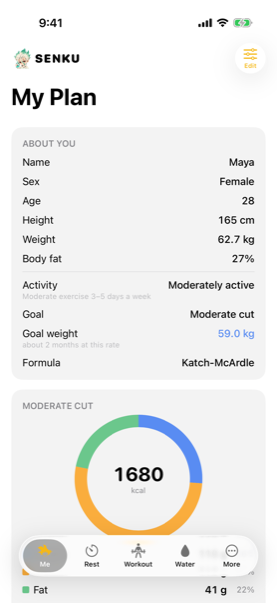

The **Me** tab is your profile and nutrition plan. At the top you will see:

- **Name, sex, age, height, weight and body fat** — the numbers the plan is built on.
- **Activity level** — how active you are outside the gym (sedentary, lightly active, moderately active, very active, or athlete).
- **Goal** — what you are trying to do: maintain, mild cut, moderate cut, aggressive cut, or the bulking equivalents.
- **Goal weight** — where you are headed and roughly how long it will take at the current rate.
- **Formula** — which equation calculates your calories (Mifflin-St Jeor or Katch-McArdle).

Below the profile is a calorie ring showing your daily target (e.g. **1680 kcal** for a moderate cut) with a breakdown of **protein**, **carbs** and **fat** in grams and percentages.

Tap **Edit** (top-right) to change any of these values. The plan recalculates immediately.

### Scrolling down — the details

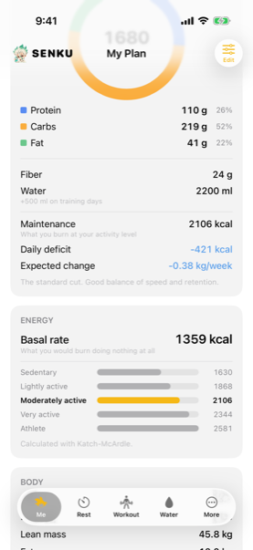

Scroll down to see:

- **Fiber** and **water** targets.
- **Maintenance calories** — what you burn at your activity level.
- **Daily deficit** (or surplus) — the gap between what you eat and what you burn.
- **Expected change** — how much weight you should lose or gain per week.
- **Energy section** — your basal rate and how it scales across activity levels, calculated with your chosen formula.
- **Body section** — lean mass and fat mass derived from your weight and body fat percentage.

---

## Rest — The Timer

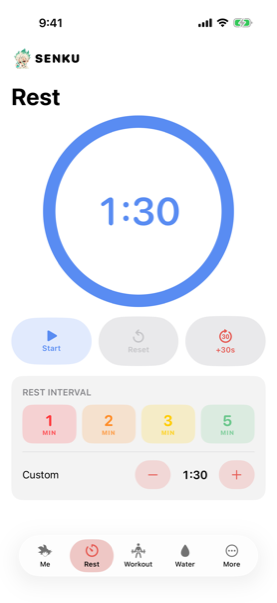

The **Rest** tab is a countdown timer for rest between sets.

### Setting the interval

- Tap one of the preset buttons: **1 min**, **2 min**, **3 min** or **5 min**.
- Or use the **Custom** row — tap **-** and **+** to adjust in 15-second steps. The current custom value is shown between the buttons (e.g. 1:30).

### Running the timer

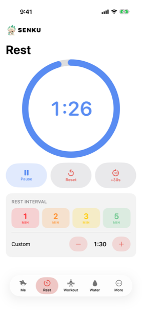

- Tap **Start** to begin the countdown.
- The large circular ring counts down visually.
- While running you can **Pause**, **Reset**, or tap **+30s** to add half a minute.
- When the timer reaches zero, a chime plays and you feel a haptic tap.

The timer also works as a **Live Activity** on the lock screen and Dynamic Island, so you can see the countdown without opening the app. If the app is in the background, the notification chime plays at the end — and it will not double up with the in-app sound.

---

## Workout — Your Week

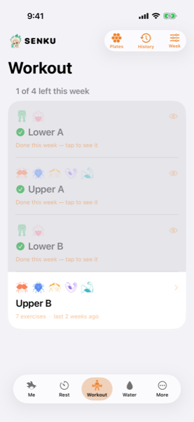

The **Workout** tab shows your weekly training plan. Each day is a card showing:

- A **green check** if you completed that session this week.
- The **session name** (e.g. Upper A, Lower B).
- **Muscle group icons** for what that session trains.
- How many exercises and when you last did it.

Sessions you have finished this week show "Done this week — tap to see it." The next session to do is expanded and ready.

At the top-right:

- **Plates** — a plate calculator for loading barbells.
- **History** — a log of past workouts.
- **Week** — the current week's summary.

### Editing your week

Tap **Edit my week** (pencil icon) to rearrange, rename, add or remove sessions. You can also import a plan from a file.

### Inside a session

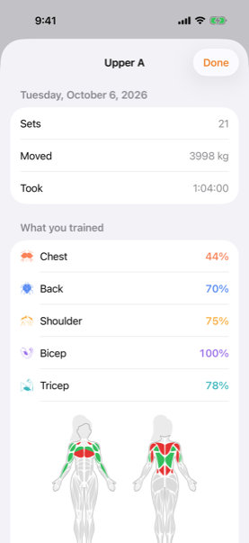

Tap a session to open it. The session screen shows:

- **Session name and date** at the top.
- **Stats**: total sets, total weight moved, and time taken.
- **What you trained**: a breakdown by muscle group, each with a percentage showing how much of that group's weekly volume this session covered.
- A **body map** at the bottom, heat-coloured to show which muscles were hit and how hard.

Tap **Done** to return to the week view.

### Logging a set — weighted exercises

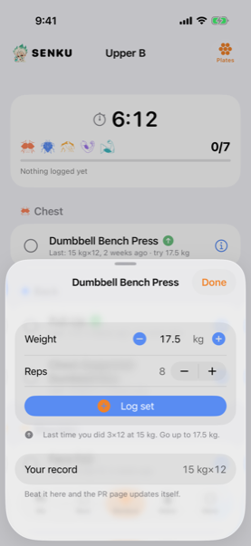

Tap an exercise in the session to open the set logger. For a weighted exercise like Dumbbell Bench Press, you will see:

- **Weight** — adjust with **-** and **+** or type directly. Shown in kg.
- **Reps** — adjust with **-** and **+** or type directly.
- **Log set** — tap to record the set.
- **Last time you did** — a reminder of what you hit previously (e.g. "3×12 at 15 kg. Go up to 17.5 kg.").
- **Your record** — your personal best for this exercise. Beat it here and the PRs page updates itself.

### Logging a set — bodyweight exercises

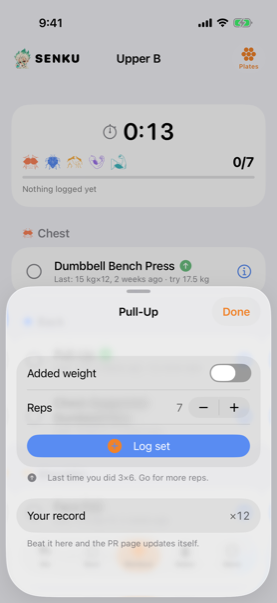

For a bodyweight exercise like a Pull-Up, the logger is simpler:

- **Added weight** — a toggle. Turn it on if you are doing weighted pull-ups (with a belt or vest). When off, no weight is saved.
- **Reps** — adjust with **-** and **+**.
- **Log set** — tap to record.
- Your last performance and personal record are shown below.

### Exercise info

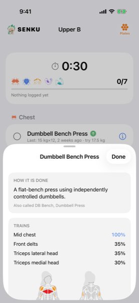

Tap the **info button** (ⓘ) next to any exercise to see:

- **How it is done** — a short description of the movement.
- **Also called** — common alternative names for the exercise.
- **Trains** — which muscles the exercise works, each with a percentage showing how much it targets that muscle. The primary muscle is highlighted in green.

### Adding an exercise — the picker

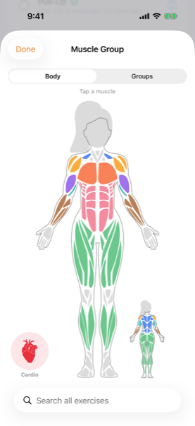

Tap **Add an exercise** at the bottom of a session to browse the full catalogue of 162 exercises. You can find exercises two ways:

- **Body map** — tap a muscle on the interactive body figure to see every exercise that trains it. Tap the smaller rear figure to flip to the back.
- **Groups** — switch to the Groups tab for a list view by muscle group.
- **Search** — type in the search bar at the bottom to search all exercises by name.
- **Cardio** — tap the heart icon for cardio exercises.

### Importing a plan

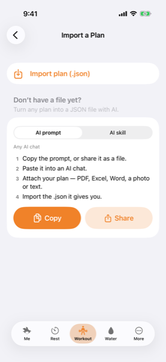

From the week editor, tap **Import a plan** to load a workout plan from a JSON file. If you do not have a file yet:

1. Copy the AI prompt (or share it as a file).
2. Paste it into any AI chat.
3. Attach your plan — PDF, Excel, Word, a photo or text.
4. Import the `.json` file the AI gives you.

Tap **Copy** to copy the prompt to your clipboard, or **Share** to send it. You can also switch to the **AI skill** tab to use it with Claude Code directly.

---

## Water

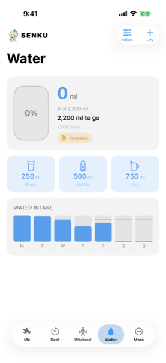

The **Water** tab tracks your daily water intake.

- The **progress bubble** at the top shows how much you have drunk today, how much is left, and your percentage.
- Below it, three quick-add buttons: **250 ml** (glass), **500 ml** (bottle) and **750 ml** (jug). Tap one to log that amount instantly.
- The **weekly chart** shows your intake for each day of the week as blue bars.
- Tap the **Streaks** badge to see your water and creatine streaks.

At the top-right:

- **Adjust** — change your daily water target and creatine tracking.
- **Log** — manually enter a custom amount.

### Creatine

Below the chart, a **creatine toggle** lets you track whether you have taken your creatine today. This feeds into your creatine streak.

### Streaks

Scroll down past the chart, or tap the **Streaks** badge, to see your streaks — how many consecutive days you have hit your water target and taken your creatine. A streak is a motivator: it costs nothing to keep and everything to break.

---

## Food

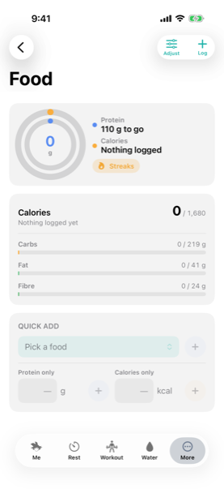

The **Food** screen (under More) tracks your daily nutrition against your plan.

At the top:

- A **protein ring** showing progress toward your protein target.
- **Calories** — a status line ("Nothing logged" or a count).
- The **Streaks** badge for calorie-target streaks.

Below that:

- **Calorie breakdown**: calories, carbs, fat and fiber — each showing current / target.
- **Quick Add**: search for a food, or add protein-only or calorie-only entries with the shortcut buttons.

At the top-right:

- **Adjust** — change your macro targets or calorie goal.
- **Log** — add a food entry with full macros.

---

## Weight

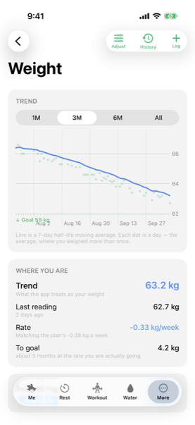

The **Weight** screen (under More) tracks your body weight over time.

### The trend chart

- A line chart showing your **7-day half-life moving average** (the smooth line) and individual weigh-ins (the dots). Multiple weigh-ins on the same day appear as separate dots.
- Switch between **1M**, **3M**, **6M** and **All** time ranges.
- Your **goal weight** is marked with a green dashed line.

### Where you are

Below the chart, the **Where you are** section shows:

- **Trend** — the smoothed weight the app treats as your current weight (e.g. 63.2 kg).
- **Last reading** — your most recent weigh-in.
- **Rate** — how fast you are losing or gaining, compared to the plan's expected rate.
- **To goal** — how much further to go and approximately how long at the current rate.

### Logging and history

Tap **Log** (top-right) to add today's weight. Tap **History** to see every weigh-in in a list, where you can delete entries. Tap **Adjust** to change your goal weight.

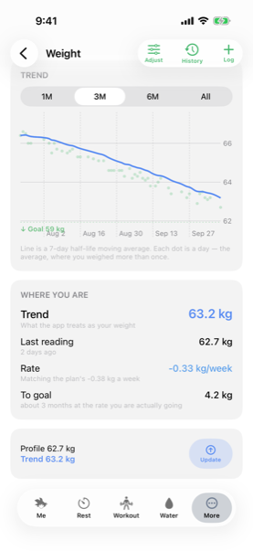

At the bottom, if your profile weight and the trend have diverged, a prompt offers to **Update** your profile to match the trend — keeping your calorie plan in sync with reality.

### Reminders

Senku can remind you to weigh in every morning at 10:00. Turn it on in **Settings → Weight → Daily reminder**. The reminder skips any morning you have already weighed in, so it never nags you after you have stepped on the scales.

---

## Personal Records (PRs)

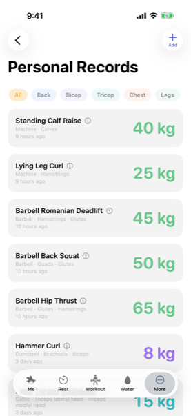

The **PRs** screen (under More) lists your personal records for every exercise you have logged.

- Filter by muscle group using the chips at the top: **All**, **Back**, **Bicep**, **Tricep**, **Chest**, **Legs**, etc.
- Each row shows the exercise name, its equipment and muscle group, how long ago the record was set, and the weight in large green text.
- Tap **Add** (top-right) to manually enter a record.

### Sharing a record

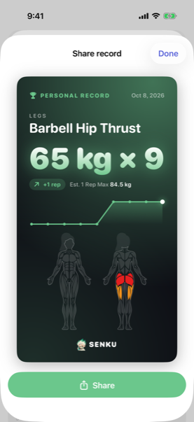

Tap a record, then tap **Share this record** to generate a share card. The card shows:

- The exercise name, muscle group and date.
- The weight and reps in large type.
- How the record improved (e.g. "+1 rep").
- Your **estimated 1-rep max**.
- A progress chart.
- A body map highlighting the muscles involved.

Tap the green **Share** button to send the card to anyone or save it as an image.

---

## Watchlist

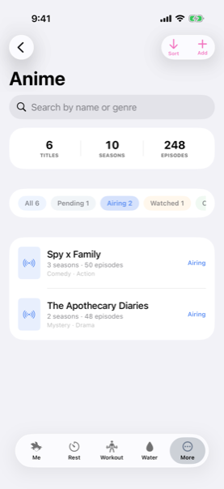

The **Watchlist** screen (under More) tracks the shows, films or series you are watching. The name defaults to "Watchlist" and you can rename it to anything — Anime, K-Dramas, Films — in the tab bar editor. At the top, a summary shows your total **titles**, **seasons** and **episodes**.

- Filter by **All**, **Pending**, **Airing**, **Watched** or **Completed**.
- Each row shows the title, season and episode count, genre tags, and its current status.
- Search by name or genre using the search bar.
- Tap **Add** (top-right) to add a new title.
- Tap **Sort** to reorder the list.

---

## Dues

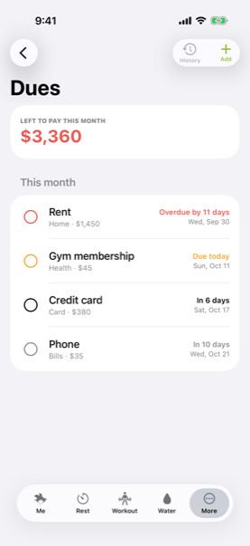

The **Dues** screen (under More) tracks your recurring bills, subscriptions and payments.

At the top, a large number shows what is **left to pay this month**.

Each due shows:

- A **progress ring** — empty is unpaid, filled is done.
- The **name**, **category** and **amount**.
- The **due date** and how many days remain — or "Overdue by X days" / "Due today" in red.

Tap **Add** (top-right) to create a new due. Tap **History** to see past payments. Senku sends you reminders before each due date (3 days before and on the day), drawn from the app's notification budget.

---

## More

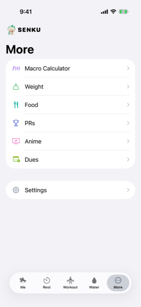

The **More** tab is the hub for everything that does not have its own tab:

- **Macro Calculator** — a standalone calculator for working out macros from scratch.
- **Weight** — your weight tracking and trend.
- **Food** — your daily nutrition log.
- **PRs** — your personal records.
- **Watchlist** — your shows, films and series.
- **Dues** — your recurring bills.
- **Settings** — app configuration.

---

## Settings

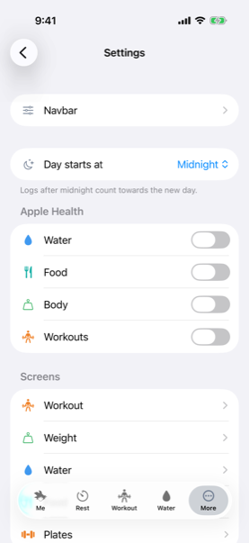

The **Settings** screen lets you configure the app:

### Navbar

Rearrange the five tabs at the bottom of the screen to put the ones you use most within easy reach.

### Day starts at

Choose when your day rolls over: **Midnight**, **1 am**, **2 am** or **3 am**. If you set it to 2 am, a glass of water at 1:30 am counts towards the day you were living, not the new calendar day. This affects totals, streaks and everything else that groups logs by day. A confirmation dialog appears before any change takes effect.

### Apple Health

Toggle which data Senku writes to Apple Health:

- **Water** — your daily water intake.
- **Food** — your calorie and macro logs.
- **Body** — your weight and body fat readings.
- **Workouts** — your completed workout sessions.

Senku only writes to Apple Health, never reads. Your data flows one way.

### Screens

Per-screen settings for:

- **Workout** — rest timer interval, session preferences.
- **Weight** — daily weigh-in reminder toggle and goal weight.
- **Water** — daily target, creatine tracking, reminder interval.
- **Plates** — available plate weights and bar weight for the plate calculator.

---

## About

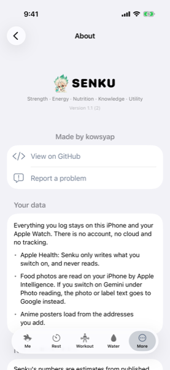

The **About** screen shows:

- **App name and version** (e.g. Version 1.1).
- **Made by kowsyap** — the developer.
- **View on GitHub** — link to the source code.
- **Report a problem** — link to file an issue.

### Your data

A privacy summary:

> Everything you log stays on this iPhone and your Apple Watch. There is no account, no cloud and no tracking.

- **Apple Health**: Senku only writes what you switch on, and never reads.
- **Food photos**: read on your iPhone by Apple Intelligence. If you switch on Gemini under Photo reading, the photo or label text goes to Google instead.
- **Watchlist posters**: loaded from the image addresses you add.

---

## Tips

- **Weigh in first thing in the morning**, before eating or drinking. Consistency matters more than the number.
- **Log water as you drink it** — the quick-add buttons are designed for single taps.
- **Use the rest timer** between every set. Consistent rest means consistent progress.
- **Check the body map** after a session to see which muscles you hit and which you missed.
- **Share your PRs** — the share cards look great and seeing progress keeps you going.
- **Set the day boundary** if you are a night owl. A 2 am boundary means a late-night snack counts towards the day you were up for.
